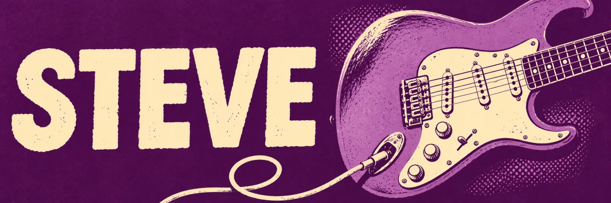

# Hi, I’m Steve

I’m a software developer and a frustrated musician. I build small tools for things I keep doing by hand. Sometimes the tool even saves time.

[Dotfiles](https://github.com/stvnbvsts/dotfiles#readme) · [Personal site](https://stvnbvsts.github.io/)

## Gigtape

I built Gigtape because before a gig, I wanted to listen to the songs the band had actually been playing on tour. It turns setlist.fm data into Spotify playlists. There’s a Go API and CLI, plus a Vue web app. [Explore Gigtape](https://github.com/stvnbvsts/gigtape#readme)

Sample playlist from In Flames at Wacken 2026

Four tracks from the set, in show order.

1. Colony
2. Cloud Connected
3. Only for the Weak
4. Take This Life

[Full setlist on setlist.fm](https://www.setlist.fm/setlist/in-flames/2026/infield-faster-stage-wacken-germany-734cbaf9.html)

## Away from the keyboard

I like spending time with my family, taking my Canon out on walks, and riding my gravel bike. I commute by bike when the weather cooperates and play guitar or bass when I have the energy. I support FC Bayern and América de Cali.

I’ve been digging into the Gothenburg death metal sound lately. In Flames, Trivium, and Black Sabbath share listening time with Pastor López and vallenato. I’ve made it to Wacken and Rock al Parque. Hellfest is still on the list.

## On repeat

Candlemass — [*Nightfall*](https://peaceville.bandcamp.com/album/nightfall)
